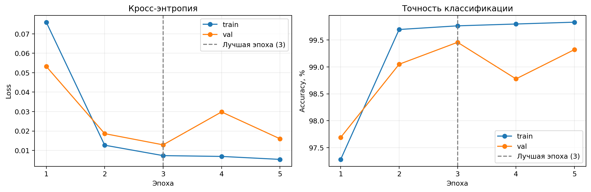
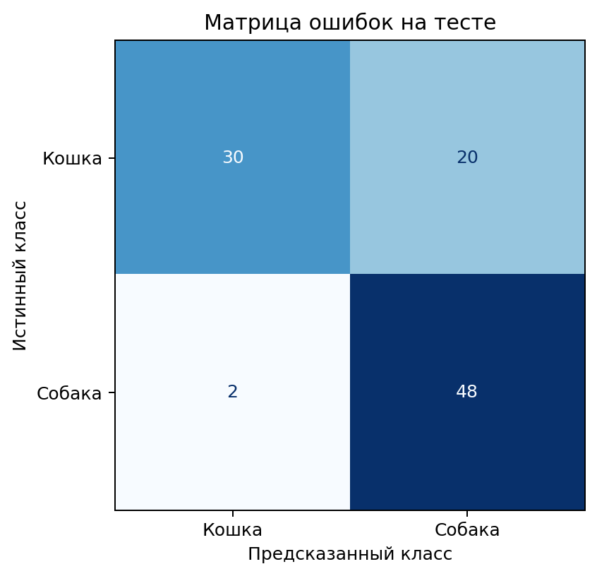

# Лабораторная работа № 3. Классификация изображений кошек и собак

Цель работы — построить систему бинарной классификации изображений на основе свёрточной нейросети. Модель принимает фотографию и определяет один из двух классов: кошка (`cat`, 0) или собака (`dog`, 1).

## Теоретическая база

Свёрточный слой применяет обучаемые фильтры к локальным участкам изображения. Первые слои выделяют границы и текстуры, а следующие объединяют эти признаки в более сложные. В ResNet выход блока складывается с его входом или проекцией входа. Такие остаточные связи помогают передавать градиент через глубокую сеть. [Статья о ResNet](https://arxiv.org/abs/1512.03385)

При переносе обучения параметры сети инициализируются весами, полученными на ImageNet, а последний слой подбирается под целевую задачу. В этой работе дообучались все слои. Сеть выдаёт два логита, и предсказанный класс соответствует большему из них. `CrossEntropyLoss` оценивает ошибку по логитам и истинной метке. `Accuracy` — доля изображений с правильным предсказанием. [Руководство по переносу обучения в PyTorch](https://docs.pytorch.org/tutorials/beginner/transfer_learning_tutorial.html)

## Описание системы

### Данные

Из Oxford-IIIT Pet использована выборка `trainval`. Взята разметка по виду животного. Данные разбиты в отношении 80/20 со стратификацией по классу и `random_state=42`. Все 3 680 фотографий из выборки прочитались. [Oxford-IIIT Pet](https://www.robots.ox.ac.uk/~vgg/data/pets/)

| Класс | Обучение | Валидация | Исходный тест | Подтверждённый тест |
| --- | ---: | ---: | ---: | ---: |
| Кошка | 950 | 238 | 50 | 45 |
| Собака | 1 994 | 498 | 50 | 41 |
| **Всего** | **2 944** | **736** | **100** | **86** |

Для внешнего теста через API iNaturalist собраны 100 фотографий из наблюдений с 2023 года. Код выбирает не более одного наблюдения каждого автора на класс. В [sources.csv](sources.csv) сохранены пути, предварительные метки, ссылки, авторство и лицензии. После исходного прогона проведена ручная проверка по сеткам в [ноутбуке](Lab3_comp_graph.ipynb). Подтверждены 86 меток. Исключены 14 кадров со следами, черепами или животными, вид которых сложно определить по кадру. Итоги разметки по каждому файлу находятся в [test_review.csv](test_review.csv). [API iNaturalist](https://api.inaturalist.org/v1/docs/)

### Предобработка и обучение

1. `PetDataset` загружает фото в RGB. Предобработка ResNet-18 масштабирует короткую сторону до 256 пикселей, вырезает центральную область 224 × 224 и нормализует каналы по статистикам ImageNet. Для обучения добавлено горизонтальное отражение с вероятностью 0,5. [Параметры предобработки Torchvision](https://docs.pytorch.org/vision/stable/models/generated/torchvision.models.resnet18.html)
2. ResNet-18 инициализируется весами ImageNet. Последний слой заменён на `Linear(512, 2)`. Сеть обучалась 5 эпох с `CrossEntropyLoss` и `AdamW`, начальная скорость обучения — `1e-4`, размер батча — 32.
3. После каждой эпохи рассчитывались средняя кросс-энтропия и точность на обучении и валидации. Чекпойнт выбирался по максимальной точности на валидации. При равной точности предпочтение отдавалось меньшему `val loss`. Внешний тест использовал выбранный чекпойнт.

### Системные требования и запуск

Эксперимент выполнен в Google Colab на NVIDIA Tesla T4. Ноутбук использует Python, PyTorch, Torchvision, pandas, Pillow, scikit-learn, Matplotlib и requests. Нужны доступ в интернет для загрузки данных и весов и свободное место для распаковки архивов Oxford-IIIT Pet. Код также поддерживает CPU.

1. Загрузите [Lab3_comp_graph.ipynb](Lab3_comp_graph.ipynb) в Google Colab и выберите среду выполнения с GPU.
2. Запустите ячейки по порядку. Ноутбук скачает тестовые фото, подготовит данные Oxford-IIIT Pet, дообучит ResNet-18 и сохранит лучший чекпойнт в `/content/resnet18_best.pth`.
3. Последние ячейки строят графики и оценивают модель на исходных 100 тестовых фото. Для расчёта метрики по проверенной разметке сопоставьте [test_predictions.csv](test_predictions.csv) с [test_review.csv](test_review.csv) по столбцу `file`, оставьте строки со статусом `confirmed` и сравните `predicted_class` с `verified_label`.

При повторном запуске состав тестовой выборки может измениться, поскольку API возвращает новые наблюдения. Файлы отчёта фиксируют состав и результаты исходного прогона. Случайность инициализации и обучения в ноутбуке отдельно не фиксируется, поэтому метрики при повторном запуске могут отличаться.

## Результаты работы и тестирования

### Обучение и валидация

| Эпоха | Train loss | Train accuracy | Val loss | Val accuracy |
| ---: | ---: | ---: | ---: | ---: |
| 1 | 0,0760 | 97,28% | 0,0532 | 97,69% |
| 2 | 0,0127 | 99,69% | 0,0187 | 99,05% |
| **3** | **0,0073** | **99,76%** | **0,0129** | **99,46%** |
| 4 | 0,0069 | 99,80% | 0,0298 | 98,78% |
| 5 | 0,0054 | 99,83% | 0,0160 | 99,32% |

Лучшая модель получена на третьей эпохе. Она правильно классифицировала 732 из 736 валидационных изображений. На четвёртой и пятой эпохах ошибка на обучении продолжала падать, а ошибка на валидации оставалась выше минимума третьей эпохи. Это признак начала переобучения. На пятой эпохе валидационные показатели частично восстановились. Полные значения приведены в [training_history.csv](training_history.csv).

### Внешний тест

На исходных 100 кадрах модель дала **78 правильных ответов из 100**. Кошек она определила в 30 случаях из 50, собак — в 48 из 50.

После проверки меток точность на 86 подтверждённых фото составила **79,07% (68/86)** по сохранённым предсказаниям.

| Истинный класс | Предсказана кошка | Предсказана собака | Доля верных ответов |
| --- | ---: | ---: | ---: |
| Кошка | 29 | 16 | 64,44% |
| Собака | 2 | 39 | 95,12% |

Кошек чаще принимали за собак. Среди таких ошибок есть [кадр с фотоловушки](https://www.inaturalist.org/photos/760735326) и [фото кошки на дальнем плане](https://www.inaturalist.org/photos/759452048). Примеры обратной ошибки видны на [фото собаки у двери](https://www.inaturalist.org/photos/762106937) и [фото собаки в траве](https://www.inaturalist.org/photos/756201531).

## Выводы

Дообученная ResNet-18 достигла 99,46% на валидации Oxford-IIIT Pet и 79,07% на подтверждённой части внешнего теста. Разрыв в 20,39 процентного пункта показывает, что качество на новой выборке заметно ниже. На внешних кадрах животные иногда занимают малую часть изображения или попадают в кадр при слабом освещении. Такие условия и дисбаланс классов при обучении могут влиять на результат. Вклад каждого фактора отдельно в этом эксперименте не измерялся.

## Использованные источники

- K. He, X. Zhang, S. Ren, J. Sun. [Deep Residual Learning for Image Recognition](https://arxiv.org/abs/1512.03385).
- O. M. Parkhi, A. Vedaldi, A. Zisserman, C. V. Jawahar. [Oxford-IIIT Pet Dataset](https://www.robots.ox.ac.uk/~vgg/data/pets/).
- PyTorch. [Transfer Learning for Computer Vision](https://docs.pytorch.org/tutorials/beginner/transfer_learning_tutorial.html) и [CrossEntropyLoss](https://docs.pytorch.org/docs/stable/generated/torch.nn.CrossEntropyLoss.html).
- Torchvision. [ResNet-18 и предобработка ImageNet](https://docs.pytorch.org/vision/stable/models/generated/torchvision.models.resnet18.html).
- iNaturalist. [Документация API](https://api.inaturalist.org/v1/docs/) и [атрибуция фотографий теста](sources.csv).
